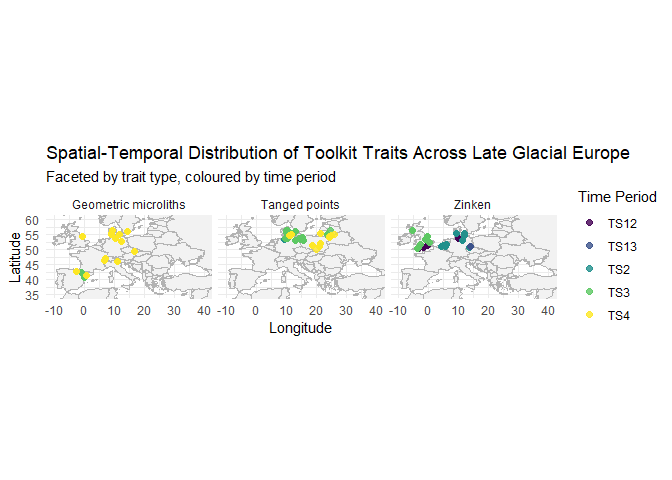

# Pan-European Classificiation


Hypothesis

I used Claude Sonnet 5 to brainstorm ideas for this section. The AI said
I should not claim “people moved” or “ideas spread”, do not write a null
that just says “there is no pattern”, do not make it vague, clustering
is not sufficient evidence, and don’t bundle all artifacts together as
they might have independently spread.

Hypothesis: The distribution of lithics (tanged points, Zinken, and
geometric microliths) across Late Glacial Europe between space and time
suggests a non-random, directional gradient. This pattern is consistent
with the claim that tool assemblages were spread via migration rather
than independent invention. Null Hypothesis: The spatial and temporal
distribution of lithics (tanged points, Zinken, and geometric
microliths) across Late Glacial Europe cannot be distinguished from
random. This is consistent with the idea that tools were independently
locally invented rather than spreading via migration between sites.
Alternative explanation:This pattern may also be produced by sampling
bias. For example, sites sampled more intensively might be overestimated
while those that were not excavated as intensively might be
underestimated.

viariables

``` r
# get file path
getwd()
```

    [1] "C:/Users/John/OneDrive - Pacific Crest Real Estate/Documents/pan-European_classification"

``` r
list.files()
```

    [1] "data"                              "lithics_project_session.md"       
    [3] "pan-European_classification.Rproj" "README.md"                        
    [5] "README.qmd"                        "README.rmarkdown"                 
    [7] "README_files"                      "Tutorial.qmd"                     

``` r
file.exists("C:\\Users\\John\\oneDrive - Pacific Crest Real Estate\\Documents\\pan-European_classification\\data")
```

    [1] TRUE

``` r
normalizePath("C:\\Users\\John\\oneDrive - Pacific Crest Real Estate\\Documents\\pan-European_classification\\data", mustWork = FALSE)
```

    [1] "C:\\Users\\John\\OneDrive - Pacific Crest Real Estate\\Documents\\pan-European_classification\\data"

``` r
# read my data 
library(dplyr)
```

    Attaching package: 'dplyr'

    The following objects are masked from 'package:stats':

        filter, lag

    The following objects are masked from 'package:base':

        intersect, setdiff, setequal, union

``` r
library(readr)

lithics <- read.csv("data/outlines_AR_fac_artefactnames_w_metric_measures.csv")


lithics %>%
  select(TaxUnit, Timeslice, Timeslice_range_from, Timeslice_range_to,
         Region, Site, Long, Lat, ToolClass) %>%
  slice(1:5)
```

       TaxUnit Timeslice Timeslice_range_from Timeslice_range_to Region      Site
    1 LEpigrav       TS1                    1                  1    ASH Esztergom
    2 LEpigrav       TS1                    1                  1    ASH Esztergom
    3 LEpigrav       TS1                    1                  1    ASH Esztergom
    4 LEpigrav       TS1                    1                  1    ASH Esztergom
    5 LEpigrav       TS1                    1                  1    ASH Esztergom
          Long     Lat ToolClass
    1 18.74034 47.7857        AR
    2 18.74034 47.7857        AR
    3 18.74034 47.7857        AR
    4 18.74034 47.7857        AR
    5 18.74034 47.7857        AR

The key variables I need to test my hypothesis are site, artifact type,
and timeslice. Testing these threee variable will allow me to analyze
the time and location of an artifact. The location where the oldest
artifact of that type is found will tell me where it might have
originated. The weakest link is region because site will tell us a more
specific region anyways. I can’t think of any more variables I might
need, the dataset contains a large amount of information.

A first look without machine learning

``` r
library(tidyverse)
```

    ── Attaching core tidyverse packages ──────────────────────── tidyverse 2.0.0 ──
    ✔ forcats   1.0.1     ✔ stringr   1.6.0
    ✔ ggplot2   4.0.3     ✔ tibble    3.3.1
    ✔ lubridate 1.9.5     ✔ tidyr     1.3.2
    ✔ purrr     1.2.2     
    ── Conflicts ────────────────────────────────────────── tidyverse_conflicts() ──
    ✖ dplyr::filter() masks stats::filter()
    ✖ dplyr::lag()    masks stats::lag()
    ℹ Use the conflicted package (<http://conflicted.r-lib.org/>) to force all conflicts to become errors

``` r
unique(lithics$ToolClass)
```

    [1] "AR" "D" 

``` r
unique(lithics$TaxUnit)
```

     [1] "LEpigrav" "AzilTECE" "LPal"     "AzilTSG"  "REpigrav" "Mag"     
     [7] "Feder"    "EpiAhr"   "ABPFeder" "EpiMag"   "ABPTishn" "Meso"    
    [13] "FMag"     "UMag"     "EMag"     "PAzil"    "EAzil"    "Sauv"    
    [19] "LAzil"    "Ham"      "Ahr"      "Brom"     "Swid"     "Bell"    
    [25] "Hav"      "Magle"    "ESauv"    "Kam"      "Wito"     "Perst"   
    [31] "Wolk"     "Plu"      "SwidAhr"  "LMagTKE"  "TransMag" "Fuerst"  
    [37] "Atzen"    "BeurA"    "EMeso"    "ELab"     "LLab"     "Cres"    
    [43] "HFeder"   "AFeder"   "FBT"     

``` r
## asked AI to create the code below:
library(tidyverse)

lithics <- read.csv("data/outlines_AR_fac_artefactnames_w_metric_measures.csv")

lithics_sub <- lithics %>%
  mutate(Trait = case_when(
    TaxUnit %in% c("Ahr", "Swid", "Brom") ~ "Tanged points",
    TaxUnit %in% c("Feder", "ABPFeder", "HFeder", "AFeder") ~ "Zinken",
    TaxUnit %in% c("Sauv", "ESauv", "Meso", "EMeso", "Magle") ~ "Geometric microliths",
    TRUE ~ NA_character_
  )) %>%
  drop_na(Trait, Long, Lat, Timeslice)

world_map <- map_data("world")

ggplot() +
  geom_polygon(data = world_map, aes(x = long, y = lat, group = group),
               fill = "grey95", colour = "grey70") +
  geom_point(data = lithics_sub, aes(x = Long, y = Lat, color = Timeslice),
             size = 2, alpha = 0.8) +
  coord_fixed(xlim = c(-10, 40), ylim = c(35, 60)) +
  facet_wrap(~ Trait) +
  scale_color_viridis_d(name = "Time Period") +
  labs(
    title = "Spatial-Temporal Distribution of Toolkit Traits Across Late Glacial Europe",
    subtitle = "Faceted by trait type, coloured by time period",
    x = "Longitude", y = "Latitude"
  ) +
  theme_minimal()
```



``` r
unique(lithics$Timeslice)
```

    [1] "TS1"  "TS2"  "TS23" "TS24" "TS34" "TS4"  "TS3"  "TS12" "TS13"

Figure 1 shows the time period and location distribution of the three
types of lithics arranged on a map. The timeslices are arranged in 1000
year intervals between 15-11 ka BP. TS12 means timeslices 1-2 and TS13
means timesclices 1-3.This figure shows that geometric microliths spread
the furthest out of all toolkits in TS4. The two TS3 points in spain of
the geometric microlith graph shows that’s where this tool kit was
likely invented and then spread from there. It also shows that Zinken
was most present in TS1, TS2, and TS3 but not in TS4. It also shows a
pattern of movement to the West because older Zinken tools were found
near Denmark and then more younger Zinken were found in the UK The
Tanged points map shows that there were seen in both Denmark and up
towards Latvia and then seen later in TS4 in between the two. This could
suggest independent invention of Tanged points tool. To further analyze
this dataset I can use ML to identify regions where toolkit traits shift
over time using the length and weight columns. This might tell us wht
the tool originated like and how it changes as it moves across space.
This would help us answer the question if tanged points were
individually invented.

Predictions My expected output will look like a FAMD factor map or a
cluster plot. My benchmark will be a null model that randomly relabels
the timescale for each point, 1,000 times. If my hypothesis is correct,
the correlation in the benchmark model will be very low while the
correlation in my model will be higher. If my null hypothesis is correct
then both the benchmark and my analysis will have a low correlation. If
my alternative explanation is correct then the benchmark and my analysis
will show low correlation.
