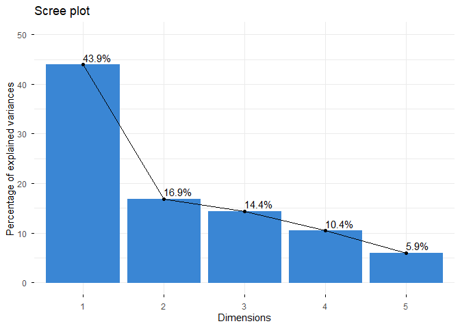
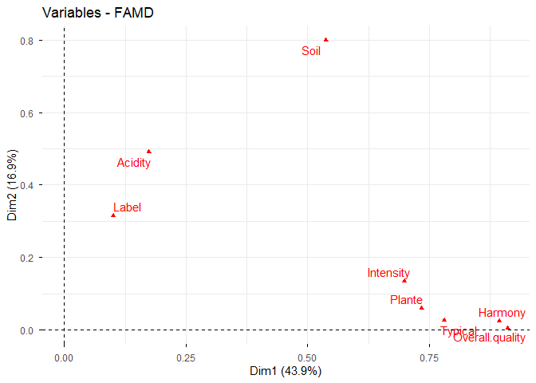
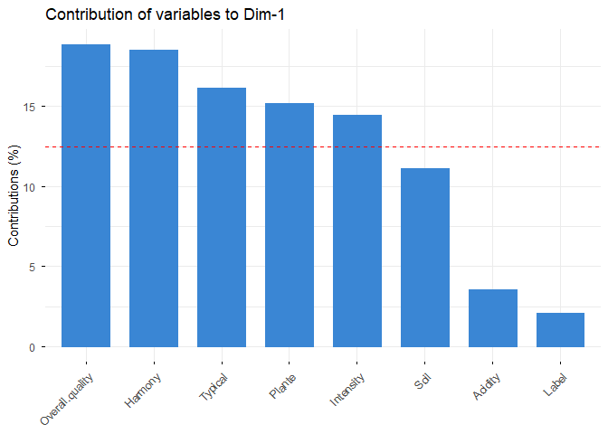
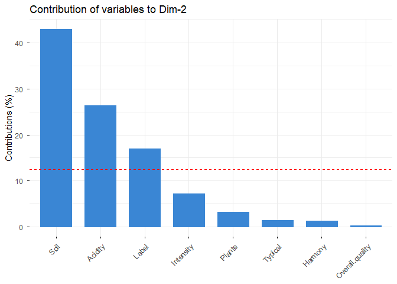
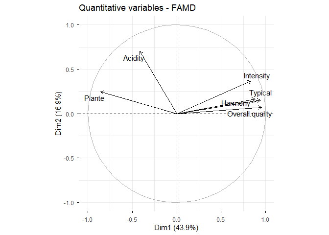
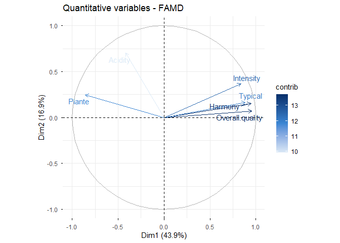
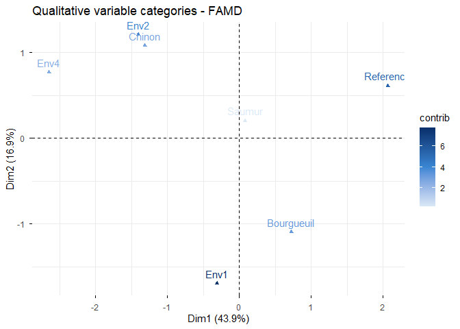
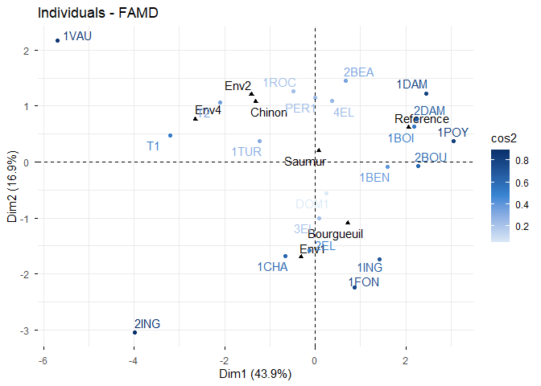
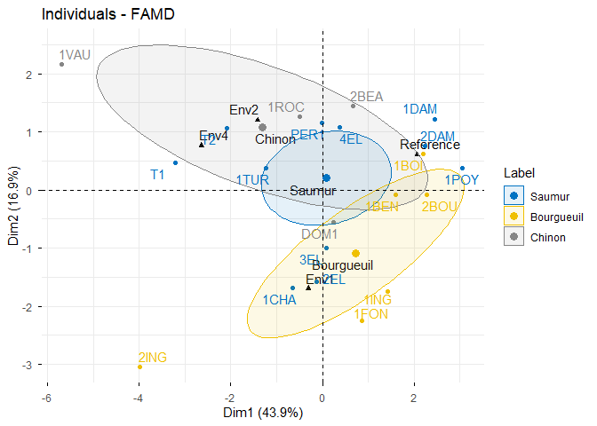
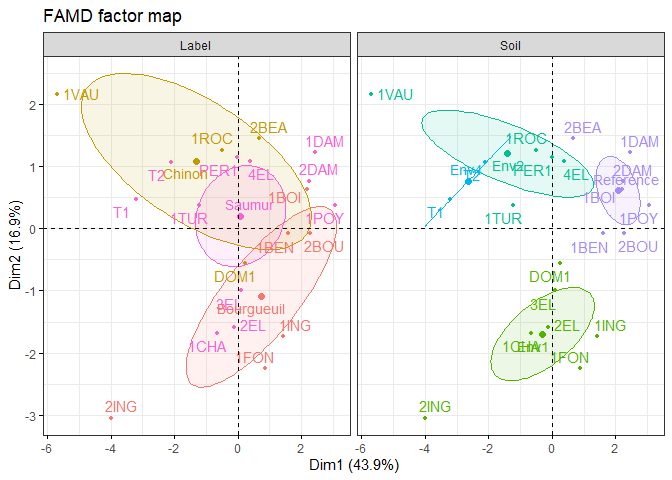

# learning FAMD classification in R
Alice Stoner

library(“FactoMineR”) library(“factoextra”)

Introduction

Tutorial

------------------------------------------------------------------------

``` r
#Tutorial
#Kassambara, A. (n.d.). Factor analysis of mixed data (FAMD) in R: Compute, visualize and interpret. Datanovia. Retrieved November 5, 2026, from https://www.datanovia.com/learn/machine-learning/dimension-reduction/factor-analysis-of-mixed-data
#I could not find an archaeological article that uses FAMD so I found one that uses MCA instead because that's something I'm also interested in using if FAMD does not work. 
#Gennai, J., Falcucci, A., Niochet, V., Peresani, M., Richter, J., & Soressi, M. (2025). Tracking the emergence of the Upper Palaeolithic in western Asia and Europe: A multiple correspondence analysis of Protoaurignacian and Southern Ahmarian lithics. PLOS ONE, 20(9), Article e0331393. https://doi.org/10.1371/journal.pone.0331393
#This journal article uses MCA analysis to examine patterns between technological traits in toolsets from Protoaurignacian and Southern Ahmarian assemblages across Western Asia and Europe. They use attributes like site, technocomplex, and various measurements for shape as their variables for their analysis to determine whether clusters occur randomly or not. They find that Southern Ahmarian and Protoaurignacian toolsets share traits meaning there may have been ties between Europe and Southwest Asia at this time.


#install FactoMineR and factoextra
library("FactoMineR")
library("factoextra")
```

    Loading required package: ggplot2

    Welcome to factoextra!

    Want to learn more? See two factoextra-related books at https://www.datanovia.com/library/principal-component-methods

``` r
#add the data 
library("FactoMineR")
data(wine)
df <- wine[, c(1, 2, 16, 22, 29, 28, 30, 31)]
head(df[, 1:7], 4)
```

              Label Soil Plante Acidity Harmony Intensity Overall.quality
    2EL      Saumur Env1  2.000   2.107   3.143     2.857           3.393
    1CHA     Saumur Env1  2.000   2.107   2.964     2.893           3.214
    1FON Bourgueuil Env1  1.750   2.179   3.143     3.074           3.536
    1VAU     Chinon Env2  2.304   3.179   2.038     2.462           2.464

``` r
# add the data
library("FactoMineR")
data(wine)
df <- wine[, c(1, 2, 16, 22, 29, 28, 30, 31)]
str(df)
```

    'data.frame':   21 obs. of  8 variables:
     $ Label          : Factor w/ 3 levels "Saumur","Bourgueuil",..: 1 1 2 3 1 2 2 1 3 1 ...
     $ Soil           : Factor w/ 4 levels "Reference","Env1",..: 2 2 2 3 1 1 1 2 2 3 ...
     $ Plante         : num  2 2 1.75 2.3 1.76 ...
     $ Acidity        : num  2.11 2.11 2.18 3.18 2.57 ...
     $ Harmony        : num  3.14 2.96 3.14 2.04 3.64 ...
     $ Intensity      : num  2.86 2.89 3.07 2.46 3.64 ...
     $ Overall.quality: num  3.39 3.21 3.54 2.46 3.74 ...
     $ Typical        : num  3.25 3.04 3.18 2.25 3.44 ...

``` r
#running FAMD
#list holding the eigenvalues
library("FactoMineR")
data(wine)
df <- wine[, c(1, 2, 16, 22, 29, 28, 30, 31)]

res.famd <- FAMD(df, graph = FALSE)
```

``` r
# running FAMD
library("FactoMineR")
data(wine)
df <- wine[, c(1, 2, 16, 22, 29, 28, 30, 31)]
res.famd <- FAMD(df, graph = FALSE)
print(res.famd)
```

    *The results are available in the following objects:

      name          description                             
    1 "$eig"        "eigenvalues and inertia"               
    2 "$var"        "Results for the variables"             
    3 "$ind"        "results for the individuals"           
    4 "$quali.var"  "Results for the qualitative variables" 
    5 "$quanti.var" "Results for the quantitative variables"

``` r
#How many dimensions are worth reading?
#first two axes together contain 61% of the data which is enough to make it meaningful
library("FactoMineR")
library("factoextra")
data(wine)
df <- wine[, c(1, 2, 16, 22, 29, 28, 30, 31)]
res.famd <- FAMD(df, graph = FALSE)

eig.val <- get_eigenvalue(res.famd)
head(eig.val)
```

          eigenvalue variance.percent cumulative.variance.percent
    Dim.1  4.8315174        43.922886                    43.92289
    Dim.2  1.8568797        16.880724                    60.80361
    Dim.3  1.5824794        14.386176                    75.18979
    Dim.4  1.1491200        10.446546                    85.63633
    Dim.5  0.6518053         5.925503                    91.56183

``` r
#get a scree plot
library("FactoMineR")
library("factoextra")
data(wine)
df <- wine[, c(1, 2, 16, 22, 29, 28, 30, 31)]
res.famd <- FAMD(df, graph = FALSE)

fviz_screeplot(res.famd, addlabels = TRUE, ylim = c(0, 50),
               barfill = "#3a86d4", barcolor = "#3a86d4")
```



``` r
#get a list with the coordinates, cos2, and contributions of all variables
library("FactoMineR")
library("factoextra")
data(wine)
df <- wine[, c(1, 2, 16, 22, 29, 28, 30, 31)]
res.famd <- FAMD(df, graph = FALSE)

var <- get_famd_var(res.famd)

# Contribution (%) of each variable to the first two dimensions
round(var$contrib[, 1:2], 2)
```

                    Dim.1 Dim.2
    Plante          15.20  3.26
    Acidity          3.59 26.45
    Harmony         18.51  1.27
    Intensity       14.47  7.25
    Overall.quality 18.87  0.28
    Typical         16.16  1.46
    Label            2.07 17.01
    Soil            11.13 43.02

``` r
#plot the variable on one map
library("FactoMineR")
library("factoextra")
data(wine)
df <- wine[, c(1, 2, 16, 22, 29, 28, 30, 31)]
res.famd <- FAMD(df, graph = FALSE)

fviz_famd_var(res.famd, repel = TRUE,
              ggtheme = theme_minimal())
```



``` r
#rate the contributers one dimension at a time
library("FactoMineR")
library("factoextra")
data(wine)
df <- wine[, c(1, 2, 16, 22, 29, 28, 30, 31)]
res.famd <- FAMD(df, graph = FALSE)

# Contribution to dimension 1
fviz_contrib(res.famd, "var", axes = 1,
             fill = "#3a86d4", color = "#3a86d4")
```



``` r
#the variables that contribute to Dim1 are Overall.quality and Harmony
#The variables that contribte to Dim2 are Soil and Acidity
library("FactoMineR")
library("factoextra")
data(wine)
df <- wine[, c(1, 2, 16, 22, 29, 28, 30, 31)]
res.famd <- FAMD(df, graph = FALSE)

# Contribution to dimension 2
fviz_contrib(res.famd, "var", axes = 2,
             fill = "#3a86d4", color = "#3a86d4")
```



``` r
# quantitative variables
library("FactoMineR")
library("factoextra")
data(wine)
df <- wine[, c(1, 2, 16, 22, 29, 28, 30, 31)]
res.famd <- FAMD(df, graph = FALSE)

quanti.var <- get_famd_var(res.famd, "quanti.var")

# Coordinates on the correlation circle
round(quanti.var$coord[, 1:2], 2)
```

                    Dim.1 Dim.2
    Plante          -0.86  0.25
    Acidity         -0.42  0.70
    Harmony          0.95  0.15
    Intensity        0.84  0.37
    Overall.quality  0.95  0.07
    Typical          0.88  0.16

``` r
#PCA correlation
library("FactoMineR")
library("factoextra")
data(wine)
df <- wine[, c(1, 2, 16, 22, 29, 28, 30, 31)]
res.famd <- FAMD(df, graph = FALSE)

fviz_famd_var(res.famd, "quanti.var", repel = TRUE,
              col.var = "black")
```



``` r
#color the arrows by contribution
library("FactoMineR")
library("factoextra")
data(wine)
df <- wine[, c(1, 2, 16, 22, 29, 28, 30, 31)]
res.famd <- FAMD(df, graph = FALSE)

fviz_famd_var(res.famd, "quanti.var", col.var = "contrib",
              gradient.cols = c("#dbe9f6", "#3a86d4", "#08306b"),
              repel = TRUE)
```



``` r
#qualitative variables
library("FactoMineR")
library("factoextra")
data(wine)
df <- wine[, c(1, 2, 16, 22, 29, 28, 30, 31)]
res.famd <- FAMD(df, graph = FALSE)

quali.var <- get_famd_var(res.famd, "quali.var")

# Coordinates of the categories
round(quali.var$coord[, 1:2], 2)
```

               Dim.1 Dim.2
    Saumur      0.08  0.20
    Bourgueuil  0.73 -1.09
    Chinon     -1.32  1.08
    Reference   2.07  0.61
    Env1       -0.31 -1.69
    Env2       -1.41  1.21
    Env4       -2.65  0.77

``` r
#plot the categories and color by contribution
library("FactoMineR")
library("factoextra")
data(wine)
df <- wine[, c(1, 2, 16, 22, 29, 28, 30, 31)]
res.famd <- FAMD(df, graph = FALSE)

fviz_famd_var(res.famd, "quali.var", col.var = "contrib",
              gradient.cols = c("#dbe9f6", "#3a86d4", "#08306b"))
```



``` r
# graph of individuals
library("FactoMineR")
library("factoextra")
data(wine)
df <- wine[, c(1, 2, 16, 22, 29, 28, 30, 31)]
res.famd <- FAMD(df, graph = FALSE)

fviz_famd_ind(res.famd, col.ind = "cos2",
              gradient.cols = c("#dbe9f6", "#3a86d4", "#08306b"),
              repel = TRUE)
```



``` r
#color individuals by group
#this is the most important figuer which shows the clusters of wine types. This plot shows that there are similarities between all of the wine flavor profiles.
library("FactoMineR")
library("factoextra")
data(wine)
df <- wine[, c(1, 2, 16, 22, 29, 28, 30, 31)]
res.famd <- FAMD(df, graph = FALSE)

fviz_famd_ind(res.famd,
              habillage = "Label",          # colour by groups
              palette = "jco",              # colourblind-safe journal palette
              addEllipses = TRUE, ellipse.type = "confidence",
              repel = TRUE)
```



``` r
#Compare several grouping variables at once
library("FactoMineR")
library("factoextra")
data(wine)
df <- wine[, c(1, 2, 16, 22, 29, 28, 30, 31)]
res.famd <- FAMD(df, graph = FALSE)

fviz_ellipses(res.famd, c("Label", "Soil"), repel = TRUE)
```



``` r
# how this method works
# we put in the data of the 21 wines. Ths includes two categorical columns and six numeric columns 
# what comes out is clusters of wine type. The axes show which variables are in each wine type. The circular areas show where these wines are similar. 
#this uses unsupervised learning. It finds similarities and clusters with no predefined labels.
#the tutorial does not use anything to check for correctness. I will be using network analysis after my FAMD to compare.
```

## My data

    ::: {.cell}

    ```{.r .cell-code}
    # read my data 
    library(tidyverse)

<div class="cell-output cell-output-stderr">

    ── Attaching core tidyverse packages ──────────────────────── tidyverse 2.0.0 ──
    ✔ dplyr     1.2.1     ✔ readr     2.2.0
    ✔ forcats   1.0.1     ✔ stringr   1.6.0
    ✔ lubridate 1.9.5     ✔ tibble    3.3.1
    ✔ purrr     1.2.2     ✔ tidyr     1.3.2
    ── Conflicts ────────────────────────────────────────── tidyverse_conflicts() ──
    ✖ dplyr::filter() masks stats::filter()
    ✖ dplyr::lag()    masks stats::lag()
    ℹ Use the conflicted package (<http://conflicted.r-lib.org/>) to force all conflicts to become errors

</div>

``` r
lithics <- read_csv("data/outlines_AR_fac_artefactnames_w_metric_measures.csv")
```

<div class="cell-output cell-output-stderr">

    New names:
    Rows: 3512 Columns: 26
    ── Column specification
    ──────────────────────────────────────────────────────── Delimiter: "," chr
    (9): Timeslice, TaxUnit, Region, Site, ShortImageRef, ToolClass, Knappi... dbl
    (17): ...1, SCALE, Timeslice_range_from, Timeslice_range_to, Long, Lat, ...
    ℹ Use `spec()` to retrieve the full column specification for this data. ℹ
    Specify the column types or set `show_col_types = FALSE` to quiet this message.
    • `` -> `...1`

</div>

:::

``` r
glimpse(lithics)
```

    Rows: 3,512
    Columns: 26
    $ ...1                 <dbl> 1, 2, 3, 4, 5, 6, 7, 8, 9, 10, 11, 12, 13, 14, 15…
    $ Timeslice            <chr> "TS1", "TS1", "TS1", "TS1", "TS1", "TS1", "TS1", …
    $ TaxUnit              <chr> "LEpigrav", "LEpigrav", "LEpigrav", "LEpigrav", "…
    $ Region               <chr> "ASH", "ASH", "ASH", "ASH", "ASH", "ASH", "ASH", …
    $ Site                 <chr> "Esztergom", "Esztergom", "Esztergom", "Esztergom…
    $ ShortImageRef        <chr> "Lengyel20082009", "Lengyel20082009", "Lengyel200…
    $ ToolClass            <chr> "AR", "AR", "AR", "AR", "AR", "AR", "AR", "AR", "…
    $ KnappingDirection    <chr> "D", "D", "D", "D", "D", "D", "D", NA, NA, NA, NA…
    $ IMAGE                <chr> "TS0_LEpigrav_ASH_Esztergom_Lengyel20082009_AR_d_…
    $ ARTEFACTNAME         <chr> "TS0_LEpigrav_ASH_Esztergom_Lengyel20082009_AR_d_…
    $ SCALE                <dbl> 0.013158, 0.013966, 0.013966, 0.013966, 0.013966,…
    $ Timeslice_range_from <dbl> 1, 1, 1, 1, 1, 1, 1, 1, 1, 1, 1, 1, 1, 1, 1, 1, 1…
    $ Timeslice_range_to   <dbl> 1, 1, 1, 1, 1, 1, 1, 1, 1, 1, 1, 1, 1, 1, 1, 1, 1…
    $ Long                 <dbl> 18.74034, 18.74034, 18.74034, 18.74034, 18.74034,…
    $ Lat                  <dbl> 47.78570, 47.78570, 47.78570, 47.78570, 47.78570,…
    $ length_cm            <dbl> 11.42, 6.23, 6.36, 5.53, 3.96, 2.51, 2.23, 6.70, …
    $ width_cm             <dbl> 2.36, 1.56, 1.15, 1.64, 0.87, 1.11, 0.83, 1.47, 1…
    $ area_cm2             <dbl> 15.94, 6.88, 5.86, 7.25, 2.11, 2.32, 1.47, 7.41, …
    $ perimeter_cm         <dbl> 24.25, 13.54, 13.84, 12.71, 8.60, 6.40, 5.54, 14.…
    $ calliper_cm          <dbl> 11.42, 6.23, 6.36, 5.53, 3.96, 2.52, 2.23, 6.71, …
    $ circularity          <dbl> 2.00, 2.32, 2.08, 2.51, 2.03, 3.27, 2.83, 2.23, 2…
    $ eccentricityeigen    <dbl> 0.05, 0.09, 0.06, 0.13, 0.05, 0.26, 0.19, 0.08, 0…
    $ AD                   <dbl> 0.16830547, 0.51472308, 0.42222367, 0.21128294, 0…
    $ BC                   <dbl> 2.132538, 2.119546, 2.025461, 2.183477, 2.134433,…
    $ amp                  <dbl> 2.300844, 2.634269, 2.447684, 2.394760, 2.389796,…
    $ sym                  <dbl> 0.07314945, 0.19539505, 0.17249924, 0.08822718, 0…

``` r
#there are 3512 rows and 26 columns. Each row represents one artifact. In the tutorial, they used all of the columns in their analysis. For the continuous data I would use toolclass in my project as label is used in the tutorial, and knapping direction as soil. I would also add the continuous column for region. For numeric data I would use length, width, area, perimeter, circularity, ecentricityeigen to replace the numeric data they used in the tutorial. 
```

## What would change for my archaeological data?

\##I would need to clean up the data before I can use it. I would need
to filter the columns so that I only use the ones I need. There may be
no correlation between the data which would mean this method is not the
best idea. I may need to use a method that only examines continuous or
numeric data. Without machine learning, archaeologists might use gis to
answer this question. You could map each artifact on an gis map and
filter the points between age/type/location to visualize what movement
might have looked like.

\##Bibliography

\#Gennai, J., Falcucci, A., Niochet, V., Peresani, M., Richter, J., &
Soressi, M. (2025). Tracking the emergence of the Upper Palaeolithic in
western Asia and Europe: A multiple correspondence analysis of
Protoaurignacian and Southern Ahmarian lithics. PLOS ONE, 20(9), Article
e0331393. https://doi.org/10.1371/journal.pone.0331393

\#Kassambara, A. (n.d.). Factor analysis of mixed data (FAMD) in R:
Compute, visualize and interpret. Datanovia. Retrieved November 5, 2026,
from
https://www.datanovia.com/learn/machine-learning/dimension-reduction/factor-analysis-of-mixed-data
